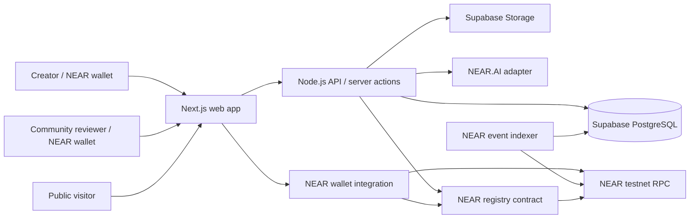

# MemeProof Technical Architecture

**Status:** Approved concept architecture for implementation planning  
**Date:** 2026-11-04  
**Initial network:** NEAR testnet

## 1. Purpose and architecture principles

MemeProof gives each supported token a public Commitment Passport. A creator records a commitment and measurable criteria, later submits evidence, and the platform records verification and community-review history.

Architecture principles:

1. **NEAR is the authoritative record** for registered tokens, commitments, evidence references, review outcomes, and status transitions. The database is a rebuildable query/index layer, not the source of truth.
2. **Evidence bytes stay off-chain.** Supabase Storage holds uploaded material; the contract records a content hash and storage reference so later changes can be detected.
3. **Verification claims are explicit and attributable.** A transaction check, AI analysis, creator submission, and community decision are separate evidence/decision types; none silently substitutes for another.
4. **Historical state is append-only.** Corrections and disputes create new events and link to prior records rather than rewriting the past.
5. **Start with a narrow supported transaction set.** Verification adapters declare which networks and transaction types they can check. Unsupported claims remain unverified and are never described as verified.
6. **Keep optional integrations out of the critical path.** SputnikDAO, Trezu, NEAR Intents, and bonds are later integrations behind separate interfaces.

## 2. System context

The user signs state-changing actions with their NEAR wallet. The web application calls the contract through a supported NEAR wallet integration. A thin Node.js service handles operations that require secrets, asynchronous work, or trusted server-side validation: uploads, AI calls, transaction verification, indexing, and API reads. It must never sign creator or voter actions on their behalf.

### Components

| Component | Responsibility | Trust boundary |
|---|---|---|
| Next.js application | Dashboard, passports, evidence submission, review UI | Untrusted client; validate all inputs again on server and contract |
| NEAR wallet integration | Connect accounts and request transaction signatures | User-controlled signing; never collect seed phrases or private keys |
| MemeProof registry contract | Canonical records, authorization, evidence references, review records, event emission | Authoritative application state on NEAR |
| Node.js API | Upload authorization, AI orchestration, transaction checks, read APIs, background job endpoints | Privileged service; minimize secrets and scope credentials |
| Supabase PostgreSQL | Searchable projections, user-facing query model, job state and audit metadata | Rebuildable; do not treat as authoritative for chain decisions |
| Supabase Storage | Evidence files and derived previews | Private by default; issue short-lived access links after authorization |
| NEAR.AI adapter | Evidence analysis and structured observations | Advisory output; store model/version and never auto-fulfill commitments |
| Indexer | Consume contract events and reconcile canonical state | Idempotent, cursor-based, restartable; detect reorg/finality behavior |

## 3. On-chain and off-chain boundary

### On-chain canonical data

- Contract schema version and supported network identifier.
- Token registration record: token identifier, display metadata URI/hash, registering account, timestamp, and registration status.
- Commitment: creator, token, immutable title/description/criteria, creation timestamp, deadline, and current derived status.
- Evidence submission: commitment id, submitter, content hash, opaque storage object key or URI, evidence kind, optional transaction reference, and timestamp.
- Review round and individual wallet decision records, including the eligibility rule/version used and the close/finalization outcome.
- Dispute and resolution records, with references to affected commitment/evidence/review records.
- Append-only status/event history emitted for indexing.

Large text, images, video, and AI reports should not be stored directly in contract state. Keep essential criteria bounded in size and put detailed supporting material in content-addressed off-chain objects. The contract should store hashes and identifiers sufficient to bind the off-chain object to the chain record.

### Off-chain data

- Evidence files, thumbnails and sanitized previews.
- Search indexes and denormalized passport view models.
- AI request/response payloads and analysis metadata, with an on-chain hash/reference for material that is presented as part of a review.
- Verification job results, provider response metadata, retry state, and cache entries.
- Rate limits, abuse signals, upload sessions, and operational logs.
- Public token descriptions and optional social links, with an integrity hash or version reference where appropriate.

### Consistency contract

Every chain mutation is the source event. The indexer projects it into Postgres using the NEAR transaction/event identifier as an idempotency key. Public pages should show indexed data with an indexing/freshness indicator and link to the corresponding transaction or explorer record. If the database disagrees with the contract, refresh/replay from chain and show the chain-backed value. Never allow a database-only update to mark a commitment fulfilled, disputed, or reviewed.

## 4. NEAR contract design

Use a Rust contract with small, explicit methods and bounded input sizes. Proposed logical modules (these may be modules within one deployed contract initially):

- **Registry:** register token identifiers, prevent duplicate registration, expose lookup/list methods.
- **Commitments:** create immutable commitments and criteria; enforce creator authorization and deadline bounds.
- **Evidence:** attach a content hash and storage reference, optionally a transaction reference; allow multiple submissions over time.
- **Review:** open/close a review period, accept one decision per eligible account per round, and finalize a transparent result.
- **Disputes:** record a dispute against a commitment or result and append its resolution.
- **Events:** emit versioned NEP-297-style events for each externally indexable state change.

Contract state transitions should be enforced on-chain. Suggested commitment statuses are `pending`, `evidence_submitted`, `fulfilled`, `failed`, and `disputed`. Status is a current summary; the underlying transition history is retained. Define the exact transition rules before coding: for example, a deadline passing alone may make a commitment eligible for failure review but should not silently prove failure if evidence/review or an explicit policy is required.

### Contract method sketch

Write methods (wallet-signed):

- `register_token(token_id, metadata_hash, metadata_uri)`
- `create_commitment(token_id, title, description, criteria, deadline)`
- `submit_evidence(commitment_id, evidence_hash, storage_ref, evidence_kind, transaction_ref)`
- `open_review(commitment_id, evidence_id, policy_id)` / `cast_vote(review_id, decision)` / `finalize_review(review_id)`
- `raise_dispute(commitment_id, evidence_id, reason_hash, reason_ref)` / `resolve_dispute(dispute_id, outcome, rationale_hash, rationale_ref)`

Read methods:

- `get_token`, `get_commitment`, `get_evidence`, `get_review`, `get_dispute`
- paginated list methods for tokens and a token's commitments
- account-indexed views for creator dashboard data

The sketch is not a frozen ABI. Add pagination, storage bounds, gas estimates, and migration/version rules during contract implementation. Avoid unbounded vectors; use indexed maps and paginated reads. Consider NEP-297 event versioning and standard NEAR account/transaction identifiers.

### Wallet holder eligibility

Eligibility is a protocol decision, not a UI filter. For MVP, choose and document a deterministic rule before enabling votes. A practical initial approach is a review round that records its eligibility policy and snapshot/block reference, with membership/weight verified by a defined on-chain token standard and contract view. If reliable snapshots or supported token standards are unavailable, launch community comments/disputes first and defer binding vote outcomes. Never accept a client-supplied balance as proof of eligibility. Prevent duplicate voting with a contract key `(review_id, account_id)`.

## 5. Data model (PostgreSQL projection)

Use UUIDs for internal rows and preserve NEAR identifiers in dedicated columns. Suggested logical tables:

| Table | Important fields |
|---|---|
| `tokens` | `id`, `network`, `contract_account`, `metadata_hash`, `creator_account`, `chain_registered_at`, `last_chain_height` |
| `commitments` | `id`, `token_id`, `chain_commitment_id`, `creator_account`, `criteria_json`, `deadline`, `current_status`, `chain_tx_hash`, `updated_chain_height` |
| `evidence` | `id`, `commitment_id`, `submitter_account`, `object_key`, `sha256`, `mime_type`, `kind`, `transaction_ref`, `chain_tx_hash`, `created_at` |
| `verification_jobs` | `id`, `evidence_id`, `adapter`, `status`, `attempt_count`, `result_json`, `checked_at`, `error_code` |
| `verification_events` | `id`, `evidence_id`, `claim_type`, `result`, `details_hash`, `source`, `source_version`, `chain_reference`, `created_at` |
| `review_rounds` | `id`, `commitment_id`, `evidence_id`, `policy_id`, `snapshot_ref`, `opens_at`, `closes_at`, `result`, `chain_tx_hash` |
| `votes` | `review_round_id`, `account_id`, `decision`, `weight`, `eligibility_proof_ref`, `chain_tx_hash`; unique `(review_round_id, account_id)` |
| `disputes` | `id`, `commitment_id`, `raised_by`, `reason_hash`, `status`, `resolution_ref`, `chain_tx_hash` |
| `chain_events` | `network`, `event_id`, `block_height`, `tx_hash`, `contract_version`, `event_json`, `processed_at`; unique `(network, event_id)` |
| `jobs` | durable asynchronous work state, lease, retries, idempotency key |

Treat SQL tables as a projection. Preserve original chain payload/event JSON for diagnostics and replay, with retention and privacy rules. Do not store sensitive account data beyond what product operation requires. Supabase RLS should deny direct writes from anonymous clients to canonical projection tables; service credentials stay server-side. Public read access should be served through carefully scoped queries/views or the API.

## 6. User and data flows

### Token registration and commitment publishing

1. Creator connects a NEAR account and selects the testnet network.
2. UI validates fields and previews the immutable commitment, criteria, and deadline.
3. Wallet signs `register_token` if needed, then `create_commitment`.
4. App waits for transaction outcome and shows pending/indexing state.
5. Indexer consumes the emitted event and updates the projection; passport is then queryable.

Token identity must be network-scoped. Registration must validate that the token identifier is well-formed and belongs to a supported token standard/account format. Metadata is descriptive and must not imply MemeProof endorses or audits the token.

### Evidence submission and analysis

1. Creator requests an upload session; API checks authentication context and applies type/size limits.
2. File is uploaded to a private Supabase Storage bucket under an opaque, non-user-controlled key.
3. API computes SHA-256 over the uploaded bytes, checks allowed MIME type from content, scans/sanitizes where available, and records object metadata.
4. Creator submits the hash/reference and any transaction claim through a wallet-signed contract call.
5. After chain confirmation, asynchronous jobs run supported transaction adapters and optionally NEAR.AI analysis.
6. Results are stored as attributed observations; relevant hashes/references are published on-chain or included in the next contract-backed review record.
7. Passport presents creator-provided evidence, automated checks, AI observations, and community decisions as distinct categories.

Avoid exposing permanent public object URLs for private or potentially sensitive evidence. The API should issue short-lived signed read links after checking public visibility policy. A public passport can expose sanitized previews and hashes while limiting original access according to an explicit evidence visibility policy.

### Transaction verification

Define adapter interfaces such as `validateReference`, `fetchTransaction`, and `evaluate(claim, transaction)`. An adapter returns a typed result: `verified`, `mismatch`, `not_found`, `unsupported`, or `temporarily_unavailable`, along with checked sender, recipient, amount, asset, status, block/height, and source timestamp. Compare normalized values with creator-declared criteria; record the exact adapter/version and query time. Retry transient provider/RPC failures with bounded backoff. Never turn unavailable into mismatch or success. The first release should support only a clearly enumerated NEAR transaction claim set.

### Community review and disputes

1. Review policy identifies who can participate, voting window, decision options, quorum/threshold, and eligibility snapshot method.
2. Review opens as a chain record tied to one evidence submission.
3. Eligible reviewers cast one wallet-signed vote. Contract enforces uniqueness and policy bounds.
4. At close, anyone or a permissionless keeper can finalize based on the contract rule; no privileged operator should choose the outcome.
5. A dispute creates a new record and may set the current commitment summary to `disputed` while preserving earlier votes and decisions.
6. Resolution records the resolving authority/process and rationale reference. A disputed result remains visibly disputed until resolved.

Avoid presenting token-weighted voting as Sybil-resistant or representative governance. Publish quorum, eligibility, snapshot and manipulation limitations next to each review result. SputnikDAO may later provide a governance path for defined disputes or policy changes; it is not required for the initial review record.

## 7. AI evidence assistant

The AI service is an analysis assistant, not an oracle or adjudicator. It may extract dates, entities, transaction identifiers, and consistency observations, and flag missing/ambiguous material. Its response must include a model/service identifier, request timestamp, prompt/schema version, evidence hash, and confidence/limitations where provided. Keep prompts and outputs auditable, but avoid sending unnecessary personal data. Do not allow AI output alone to change commitment status, establish transaction finality, or resolve a dispute. Handle model unavailability as `analysis_unavailable`; users may still submit evidence.

Place NEAR.AI behind an adapter so model endpoints and payload formats can change without changing contract interfaces. Before implementation, confirm the available NEAR.AI service/API, data retention, and testnet access.

## 8. API and application boundaries

Suggested API responsibilities (exact routing is implementation-time):

- Read passport and dashboard projections with pagination and network scoping.
- Create, complete, and revoke upload sessions; enforce quotas and evidence policy.
- Fetch signed evidence links after authorization.
- Start or inspect verification and AI jobs using idempotency keys.
- Return job and indexer freshness state.

Chain writes should normally be wallet-originated. Server endpoints must not accept a wallet account identifier as authentication by itself: validate signed messages where server-side access control is needed, or use chain transaction proof. Keep Supabase service-role keys, AI credentials, and any RPC provider credentials in server-only environment configuration. Apply request validation, rate limiting, CORS/CSRF protections appropriate to the auth pattern, and safe error responses.

## 9. Security, abuse, and privacy

- **Wallet security:** rely on wallet signing; never request or store private keys. Clearly show network/account before signing.
- **Contract safety:** authorization on every write, input and storage limits, checked arithmetic, duplicate prevention, explicit status transitions, versioned events, and independent review before mainnet.
- **Evidence integrity:** hash exact uploaded bytes, use opaque object keys, prevent overwrite, retain evidence references, and show whether a file hash matches.
- **Malicious files:** allowlist file types and sizes, validate content rather than extension, sanitize previews, and isolate processing.
- **AI prompt injection:** treat file content as untrusted data; constrain tool access and output schema; never permit model-directed writes.
- **Voting abuse:** one account per round, policy-based eligibility snapshot, disclose concentration and Sybil limits, rate-limit ancillary endpoints.
- **Indexing:** idempotent event ingestion, checkpoint/cursor persistence, replay and reconciliation, alert on gaps or contract version mismatch.
- **Secrets:** environment-based server configuration, least privilege, key rotation, no secrets in client bundles/logs/repository.
- **Privacy:** explain that NEAR account actions and hashes are public and permanent. Avoid putting personal details or confidential evidence on-chain. Provide a file visibility and retention policy before public uploads.
- **Operational controls:** structured audit logs, abuse/report path, backups, dependency updates, and incident procedures before production launch.

## 10. Deployment and environments

### Development/testnet

- Next.js deployment with preview environments and a testnet configuration.
- Rust contract deployed to a dedicated testnet account; contract account and network explicitly configured in frontend/API.
- Supabase development project with private storage bucket, RLS policies, and migration-managed schema.
- Node API/background worker with separate development secrets.
- Test data and wallets must be clearly separated from any future production environment.

### Production readiness

Before mainnet: contract security review and reproducible build; production deployment runbook; database backup/restore and index replay; rate limits and monitoring; privacy and evidence retention policy; incident response; migration and contract upgrade policy; domain and wallet network protections. Do not reuse testnet credentials or storage buckets.

### Observability

Track API error rate/latency, upload failures, AI/verification job age and failure categories, indexer lag and event gaps, RPC availability, contract transaction failures, storage usage, and database health. Do not log evidence contents, signed URLs, access tokens, or unnecessary personal information.

## 11. Delivery phases and acceptance gates

### Phase 0: protocol and policy specification

- Freeze token identity format, commitment fields and limits, status transition rules, evidence visibility, transaction verification scope, and review eligibility/result policy.
- Confirm NEAR wallet integration, NEAR.AI API/access, and Supabase environment approach.
- Define event schema and contract upgrade strategy.

### Phase 1: testnet accountability core

- Wallet connection, token registration, immutable commitment creation, evidence upload/hash, public passport, chain event indexer.
- Clearly label evidence as creator-submitted; include chain links and status/history.
- Acceptance: restart/replay indexer without duplicate rows; verify stored file hash; display original criteria and chain transaction references.

### Phase 2: verification and review

- Add supported NEAR transaction adapters, review rounds, duplicate-vote prevention, result finalization, disputes, and audit history.
- Acceptance: exercise positive, mismatch, unsupported, unavailable, duplicate vote, deadline, and dispute paths on testnet; UI distinguishes each source of judgment.

### Phase 3: AI assistance and hardening

- Integrate NEAR.AI behind the adapter, add abuse controls, monitoring, retention, and security review.
- Acceptance: AI output is versioned and attributable, unavailable analysis does not block evidence submission, and it cannot directly alter canonical status.

### Later integrations

- SputnikDAO for selected governance processes, Trezu treasury references/integration, NEAR Intents cross-chain flows, and commitment bonds after product and contract policies are proven.
- Each integration should be optional, independently deployable, and must not weaken the chain-backed history.

## 12. Key decisions still required before implementation

1. What exactly identifies a token (NEP-141 contract account only for MVP, or other forms), and who may register it?
2. Which commitment fields and criteria types are immutable, and which transaction criteria can the first adapter validate?
3. What event causes `fulfilled` or `failed`: deterministic transaction check, community threshold, creator action, or a combination? Define who can appeal and how disputes affect current status.
4. What is the eligibility and voting rule, including snapshot method, quorum, decision threshold, and review duration? If unresolved, defer binding voting.
5. Are evidence files public, private to reviewers, or creator-selected? What are file-size, retention, takedown, and personal-data rules?
6. Which NEAR.AI product/API is available and acceptable for the evidence data being sent?
7. Which NEAR wallet integration and indexer/RPC strategy will be used at implementation time? Confirm current ecosystem support and finality/reconciliation behavior.
8. What contract upgrade model and admin/governance authority are acceptable for testnet and later mainnet?

These are policy and integration choices that should be resolved before fixing the contract ABI. The approved product direction does not require bonds, treasury custody, cross-chain execution, or DAO governance in the initial release.
